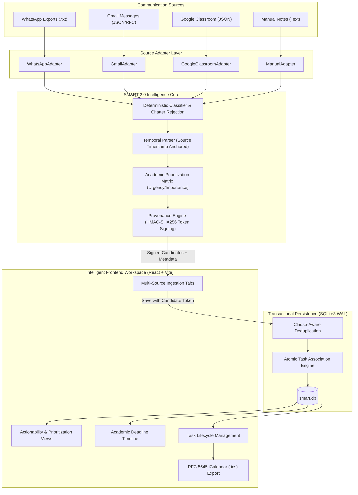

# SMART 2.0 — Academic Communication Intelligence & Task Management System

SMART 2.0 is a privacy-preserving, local-first academic communication intelligence platform. It analyzes high-volume student communication streams—WhatsApp group chats, Gmail academic notifications, Google Classroom announcements/coursework, and manual task notes—and extracts actionable academic notices, assignment deadlines, exam timetables, workshops, and opportunities.

SMART operates with zero reliance on external or paid cloud AI APIs, using deterministic, explainable, and tamper-resistant extraction algorithms backed by HMAC cryptographic provenance.

---

## 1. System Architecture & Capabilities



### Core Capabilities
1. **Multi-Source Ingestion**: Pluggable source adapters decouple communication platforms (WhatsApp, Gmail, Google Classroom, Manual) into a normalized `SourceMessage` representation.
2. **Deterministic Information Extraction**: Rigorous word-boundary regex patterns classify tasks into `Assignment`, `Exam`, `Announcement`, `Event`, and `Opportunity`, rejecting negative directives and conversational student chatter.
3. **Temporal Intelligence**:
   - Anchors relative dates (`tomorrow`, `this Friday`, `next Monday`, `in 2 weeks`) strictly to the original source message timestamp rather than the current system clock.
   - Accurately differentiates `by Monday` (due on Monday) from `before Monday` (due Sunday).
   - Extracts explicit 12-hour and 24-hour clock times and normalizes date ranges (`2026-11-25 to 2026-11-28`).
   - Flags ambiguous dates or historical events for human review.
4. **Intelligent Prioritization Matrix**:
   - Calculates dynamic urgency scores based on remaining days (`Overdue`, `Urgent <= 2d`, `Approaching <= 7d`, `Scheduled > 7d`).
   - Assigns multi-factor importance (`CRITICAL`, `HIGH`, `NORMAL`, `LOW`) from academic keywords and deliverables.
   - Evaluates actionability (`action_required` vs `informational`).
5. **Cryptographic Provenance & Tamper Resistance**:
   - Extraction candidates are cryptographically bound to exact character evidence offsets, confidence metrics, and source platform metadata via HMAC SHA-256 tokens.
   - Clients cannot forge confidence scores, external platform origins (`gmail`, `google_classroom`), or modify source metadata without invalidating the token.
6. **Transactional Task Association**:
   - Deadline modifications (extensions, postponements, cancellations, revisions) atomically transition predecessor tasks (`superseded`, `cancelled`) in a single SQLite immediate transaction.
   - Multi-task deduplication safely allows distinct tasks from the same announcement to coexist while rejecting duplicate saves.
7. **RFC 5545 iCalendar Export**: Generates compliant `.ics` calendars with DTSTART/DTEND, explicit times, all-day event fallbacks, 75-octet line folding, and character escaping.

---

## 2. Directory Structure

```
SMART/
├── .env.example                       # Production & development configuration template
├── README.md                          # Comprehensive documentation
├── SMART_DEVELOPMENT_LOG.md           # Engineering development log & milestone history
├── backend/
│   ├── calendar_export.py             # RFC 5545 iCalendar generator
│   ├── database.py                    # SQLite schema, transactions, migrations & queries
│   ├── extractor.py                   # Academic categorization, segmentation, HMAC signing
│   ├── main.py                        # FastAPI application endpoints & lifecycle
│   ├── parser.py                      # WhatsApp chat parser (Android/iOS multiline)
│   ├── requirements.txt               # Backend Python dependencies
│   ├── source_adapters.py             # SourceMessage contracts and platform adapters
│   ├── temporal_parser.py             # Anchor-based relative date and time parsing
│   ├── data/                          # SQLite persistent storage (smart.db)
│   └── tests/                         # Pytest test suite (280+ tests)
└── frontend/
    ├── index.html                     # Frontend HTML entry point
    ├── package.json                   # Vite, React, Vitest dependencies & scripts
    ├── vite.config.js                 # Vite bundler configuration
    └── src/
        ├── App.jsx                    # React academic dashboard application
        ├── App.css                    # Visual design, color tokens & responsiveness
        ├── api.js                     # Centralized API client
        └── utils/                     # Confidence filtering & prioritization logic
```

---

## 3. Technology Stack

- **Backend**:
  - Python 3.10+ (tested on Python 3.14)
  - FastAPI 0.115+
  - Starlette & Uvicorn
  - Pydantic v2
  - Python Standard Library: `sqlite3`, `hmac`, `hashlib`, `re`, `datetime`
- **Frontend**:
  - React 19
  - Vite 8
  - Native ES Modules & Fetch API
  - Modern CSS (Flexbox, Grid, CSS Variables)
- **Quality & Verification**:
  - Pytest (Backend automated tests)
  - Vitest (Frontend unit and E2E integration tests)
  - ESLint (Frontend static analysis)

---

## 4. Setup & Running the Application

### Prerequisites
- **Python 3.10+**
- **Node.js 18+** with `npm`

### Step 1: Environment Configuration
Copy `.env.example` to `.env` (optional for local development, as safe defaults are built in):
```bash
cp .env.example .env
```

Key environment variables:
| Variable | Default | Purpose |
| :--- | :--- | :--- |
| `HOST` | `127.0.0.1` | Backend bind host address. |
| `PORT` | `8000` | Backend bind port. |
| `SMART_DB_PATH` | `backend/data/smart.db` | SQLite database file location. |
| `SMART_PROVENANCE_SECRET` | *(Random ephemeral key)* | 32-byte hex key for HMAC candidate tokens. |
| `VITE_API_URL` | `http://127.0.0.1:8000` | Backend API base URL for frontend requests. |

### Step 2: Backend Setup & Execution
From the project root:
```bash
# 1. Install dependencies
py -m pip install -r backend/requirements.txt

# 2. Start FastAPI development server
py -m uvicorn backend.main:app --reload --host 127.0.0.1 --port 8000
```
- API Base: `http://127.0.0.1:8000`
- Interactive API Docs: `http://127.0.0.1:8000/docs`
- Health Endpoint: `http://127.0.0.1:8000/api/health`

### Step 3: Frontend Setup & Execution
In a separate terminal from the project root:
```bash
# 1. Navigate to frontend
cd frontend

# 2. Install dependencies
npm install

# 3. Start Vite dev server
npm run dev
```
- Frontend UI: `http://localhost:5173`

---

## 5. Automated Verification Suite

Run all quality gates with a single set of commands:

```bash
# Backend pytest suite (280+ tests)
py -m pytest -q

# Frontend Vitest suite (80+ tests)
npm --prefix frontend test -- --run

# Frontend code linting (0 errors, 0 warnings)
npm --prefix frontend run lint

# Frontend production asset build
npm --prefix frontend run build

# Git diff check (no whitespace or format regressions)
git diff --check
```

---

## 6. API Reference

### Source Ingestion & Extraction
- `POST /api/extract-academic-source`: Universal extraction endpoint accepting `source_type` (`whatsapp`, `gmail`, `google_classroom`, `manual`) and raw payload or text.
- `POST /api/upload-chat`: Parses uploaded WhatsApp `.txt` file into structured chat messages.
- `POST /api/extract-academic`: Direct extraction from parsed WhatsApp messages.

### Persistence & Task Management
- `GET /api/academic-items`: Retrieves saved items with support for search, category, status, importance, urgency, and source_type filtering.
- `POST /api/academic-items`: Validates and saves candidate tasks with HMAC token verification, deduplication, and atomic predecessor transitions.
- `GET /api/academic-items/{id}`: Retrieves a single academic task by ID.
- `PATCH /api/academic-items/{id}`: Updates status (`pending`, `completed`, `dismissed`, `superseded`, `cancelled`).
- `DELETE /api/academic-items/{id}`: Deletes a saved academic task.
- `GET /api/academic-items/export-ics`: Exports confirmed academic deadlines as an RFC 5545 `.ics` calendar file.

---

## 7. Production & Security Considerations

1. **Local-First Privacy**: All parsing, natural language extraction, and task management run entirely on the host machine. No academic data, student correspondence, or message snippets leave the system.
2. **Cryptographic Secret Rotation**: In production, configure a static `SMART_PROVENANCE_SECRET` in `.env` to ensure HMAC candidate tokens remain valid across server restarts and across multi-worker deployments.
3. **Write-Ahead Logging (WAL)**: SQLite operates in WAL mode (`PRAGMA journal_mode = WAL;`) for concurrent read/write operations without table locking.
4. **Input Sanitization**: All database queries use parameterized SQL statements to eliminate SQL injection vulnerabilities.
5. **CORS Restrictions**: For production deployments, adjust CORS allowed origins in `backend/main.py` to match the production domain.
