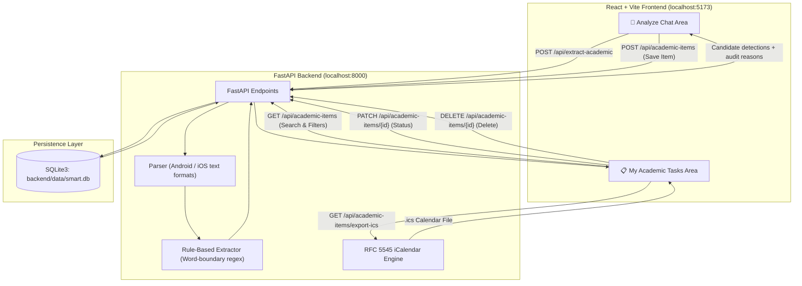

# SMART — Academic Intelligence Dashboard (Phase 2)

SMART is a privacy-preserving, local-first academic communication intelligence and task management application. It surfaces crucial educational notices, assignment deadlines, exam circulars, workshops, and opportunities buried inside high-volume group chat exports, and enables students to manage and export their deadlines without relying on cloud services.

---

## 1. Objective & Architecture

Phase 2 transforms SMART from a temporary chat analysis demo into a persistent academic task management system:

`Upload chat → Extract candidate items → Review source evidence → Save selected items → Manage tasks → Export confirmed deadlines`

### System Architecture



### Component Structure
- `backend/database.py`: SQLite connection management, schema initialization, parameterized queries, deduplication, and task CRUD operations.
- `backend/calendar_export.py`: RFC 5545 iCalendar serialization, character escaping (`\`, `;`, `,`, `\n`), and 75-octet line folding.
- `backend/parser.py`: Robust multiline WhatsApp chat export parser supporting 12h/24h timestamps and Unicode formatting marks.
- `backend/extractor.py`: Rule-based extraction, conservative date resolution, and review flags.
- `backend/main.py`: FastAPI application routing, request validation, CORS middleware, and lifespan schema setup.
- `backend/tests/`: Automated pytest suite (41 tests) covering parser, extractor, database CRUD, deduplication, filters, and export.
- `frontend/src/api.js`: Shared API client and base URL configuration.
- `frontend/src/App.jsx`: Responsive UI featuring dual tabs ("Analyze Chat" and "My Academic Tasks"), candidate saving, status controls, filter panels, and accessible modals.
- `frontend/src/App.css`: Modern visual styling with accessible focus rings, status badges, and responsive layouts.

---

## 2. SQLite Database & Persistence

- **Database Engine:** Python's standard library `sqlite3` with Write-Ahead Logging (`PRAGMA journal_mode = WAL;`) and foreign keys enabled.
- **Default Location:** `backend/data/smart.db` (the directory is created automatically on application startup).
- **Environment Override:** Set the `SMART_DB_PATH` environment variable to use an alternate database file (used automatically during automated tests for isolation).
- **Git Safety:** The database and journal files are ignored via `.gitignore` (`backend/data/*.db`, `*.sqlite`, `*.db`). The `backend/data/.gitkeep` file ensures the directory structure exists in version control.

### Table Schema: `academic_items`

| Column | Type | Description |
| :--- | :--- | :--- |
| `id` | `INTEGER PRIMARY KEY AUTOINCREMENT` | Unique identifier for each saved task. |
| `title` | `TEXT NOT NULL` | Title of the academic notice or deadline. |
| `category` | `TEXT NOT NULL` | `Assignment`, `Exam`, `Announcement`, `Event`, or `Opportunity`. |
| `description` | `TEXT` | Detailed description or context. |
| `date_text` | `TEXT` | Raw date expression from the chat. |
| `due_date` | `TEXT` | Nullable ISO date string (`YYYY-MM-DD`). |
| `date_type` | `TEXT` | `deadline`, `mentioned_date`, `event_date`, or `unknown`. |
| `date_status` | `TEXT` | Confidence status (e.g. `confirmed_explicit`, `needs_review`). |
| `status` | `TEXT NOT NULL` | Task lifecycle: `pending`, `completed`, or `dismissed`. |
| `source_sender` | `TEXT` | Name or number of the message sender. |
| `source_timestamp`| `TEXT` | Original timestamp string from the chat export. |
| `source_text` | `TEXT NOT NULL` | Full, unaltered original WhatsApp message text. |
| `source_filename` | `TEXT` | Name of the source `.txt` file. |
| `review_required` | `INTEGER NOT NULL` | `0` or `1` boolean flag. |
| `review_reasons` | `TEXT` | JSON-serialized array of audit strings. |
| `created_at` | `TEXT NOT NULL` | UTC ISO 8601 timestamp. |
| `updated_at` | `TEXT NOT NULL` | UTC ISO 8601 timestamp. |

### Indexes
- `idx_academic_items_category` on `category`
- `idx_academic_items_status` on `status`
- `idx_academic_items_due_date` on `due_date`
- `idx_academic_items_dedup` on `(source_text, source_timestamp, source_sender, category)`

### Deduplication Strategy
To prevent accidental duplicate saves when users re-analyze chats or click save multiple times, SMART verifies source provenance against existing records:
`source_text`, `source_timestamp`, `source_sender`, `category`, and `source_filename`.
If an identical item already exists, `POST /api/academic-items` returns `409 Conflict` with the existing task ID, and the frontend updates the card to show **"✓ Already Saved"**. Two genuine distinct messages with the same title are never blocked.

---

## 3. API Reference

### Health & Analysis
- `GET /api/health`: Health status and project metadata.
- `POST /api/upload-chat`: Parses uploaded `.txt` file into structured messages.
- `POST /api/extract-academic`: Extracts candidate academic items, flags uncertain dates, and categorizes messages.

### Persistence & Task Management (Phase 2)
- `POST /api/academic-items`:
  - Validates and saves a candidate item.
  - Returns `201 Created` with the persisted record.
  - Returns `409 Conflict` if the item is already saved.
  - Returns `400 Bad Request` if category, status, or date formats are invalid.
- `GET /api/academic-items`:
  - Retrieves saved academic items with deterministic sorting: upcoming dated items first chronologically, followed by undated items, with newest first.
  - Query parameters:
    - `category`: Filter by `Assignment`, `Exam`, `Announcement`, `Event`, `Opportunity`.
    - `status`: Filter by `pending`, `completed`, `dismissed`.
    - `search`: Keyword search across `title`, `description`, and `source_text`.
    - `due_before`: ISO date (`YYYY-MM-DD`).
    - `due_after`: ISO date (`YYYY-MM-DD`).
- `GET /api/academic-items/{item_id}`:
  - Retrieves a single saved academic item. Returns `404` if not found.
- `PATCH /api/academic-items/{item_id}`:
  - Updates the task status (`{"status": "completed"}`). Updates `updated_at`. Returns `404` if not found, `400` if status is invalid.
- `DELETE /api/academic-items/{item_id}`:
  - Permanently deletes the task. Returns `404` if not found.
- `GET /api/academic-items/export-ics` (alias: `export.ics`):
  - Generates and downloads an RFC 5545 compliant `.ics` calendar containing only saved items with a valid `due_date` and `date_type="deadline"`.
  - Excludes mentioned dates, event dates, and undated items.
  - Returns `404` with a descriptive message if no confirmed deadlines exist.

---

## 4. Setup & Running the Application

### Prerequisites
- **Python**: 3.10+ (tested on Python 3.14)
- **Node.js**: 18+ (tested on Node.js with Vite 8)

### Running the Backend
From the project root:
```bash
# 1. Install backend dependencies
py -m pip install -r backend/requirements.txt

# 2. Run the FastAPI development server
py -m uvicorn backend.main:app --reload --host 127.0.0.1 --port 8000
```
Backend will be available at `http://127.0.0.1:8000`. Test health at `http://127.0.0.1:8000/api/health`.

### Running the Frontend
In a separate terminal:
```bash
# 1. Navigate to frontend directory
cd frontend

# 2. Install dependencies (if not already installed)
npm install

# 3. Start Vite dev server
npm run dev
```
Frontend will be available at `http://localhost:5173`. Open this URL in your web browser.

---

## 5. Running Automated Tests

### Backend Test Suite (pytest)
From `backend/`:
```bash
py -m pytest -v
```
All **41 automated tests** run against an isolated temporary SQLite database (configured via `conftest.py`), leaving your development database untouched:
1. `test_database_initialization`: Verifies table creation and index setup.
2. `test_save_academic_item_api`: Validates persistence via `POST /api/academic-items`.
3. `test_list_saved_items_deterministic_ordering`: Verifies chronological ordering for dated items and subsequent undated items.
4. `test_search_and_category_filters`: Verifies search and category query parameters.
5. `test_status_filters`: Verifies pending, completed, and dismissed filters.
6. `test_date_range_filters`: Verifies `due_before` and `due_after` filtering.
7. `test_update_task_status_lifecycle`: Verifies transitions between pending, completed, and dismissed, and timestamp updates.
8. `test_invalid_status_and_dates_rejected`: Verifies 400 Bad Request on invalid inputs.
9. `test_nonexistent_item_ids_return_404`: Verifies 404 responses for missing items.
10. `test_delete_saved_item`: Verifies deletion and subsequent 404 responses.
11. `test_duplicate_save_rejected_with_conflict`: Verifies deduplication and 409 Conflict.
12. `test_export_confirmed_deadlines_ics`: Verifies RFC 5545 format, headers, UIDs, and VEVENT generation.
13. `test_export_excludes_non_deadlines`: Verifies non-deadlines and undated items are excluded from `.ics`.
14. `test_icalendar_text_escaping`: Verifies RFC 5545 escaping of backslashes, semicolons, commas, and newlines, and 75-octet line folding.
15. Existing parser, extractor, upload, and health check regression tests (27 tests).

### Frontend Verification (ESLint & Vite Build)
From `frontend/`:
```bash
npm run lint
npm run build
```
Builds production assets cleanly with 0 warnings or errors.

---

## 6. End-to-End Workflow Walkthrough

Use the synthetic test fixture at `backend/tests/fixtures/sample_chat.txt` to test the complete workflow:

1. **Upload & Extract:**
   - Go to `http://localhost:5173`.
   - On the **"Analyze Chat"** tab, drag and drop `backend/tests/fixtures/sample_chat.txt`.
   - Click **"Analyze conversation →"**.
2. **Review Evidence:**
   - View extracted candidate cards (e.g., Assignment 3 submission, Machine Learning Internal Test).
   - Expand **"Inspect Original Source Evidence"** to review the exact sender, timestamp, and message.
3. **Save to Task Management:**
   - Click **"+ Save to Tasks"** on the Assignment 3 card.
   - The button transitions through a loading spinner and updates to **"✓ Already Saved"**.
4. **Manage Tasks:**
   - Click the **"📋 My Academic Tasks"** tab in the navigation bar.
   - Observe the saved task displayed with its category color pill, status badge (**PENDING**), and due date.
   - Click **"✓ Completed"** to update its status. The card updates dynamically and the completed counter increases.
   - Test search and category filters.
5. **Export Confirmed Deadlines:**
   - Click **"Export Confirmed Deadlines (.ics)"**.
   - Your browser downloads `smart_academic_deadlines.ics`.
   - Open the `.ics` file in Microsoft Outlook, Apple Calendar, or Google Calendar to confirm the deadline event appears on the correct date without invented times.
6. **Safe Deletion:**
   - Click **"🗑 Delete"** on a saved task.
   - Confirm via the accessible modal dialog. The item is removed from the database without altering the original chat file.

---

## 7. Privacy & Security Principles

1. **100% Local Execution:** Chat parsing, information extraction, and database persistence run entirely on your local machine. No student chat logs or tasks are sent to external servers or cloud AI providers.
2. **No Executable Content:** Uploaded chat files are parsed as plain text and discarded after extraction. File contents are never stored as executable binaries.
3. **Single-User Prototype Scope:** This version is intentionally designed as an offline single-user prototype without authentication overhead.
4. **Evidence Preservation:** Every saved academic item preserves the exact sender, timestamp, and message text so students can verify instructions directly with official sources.
