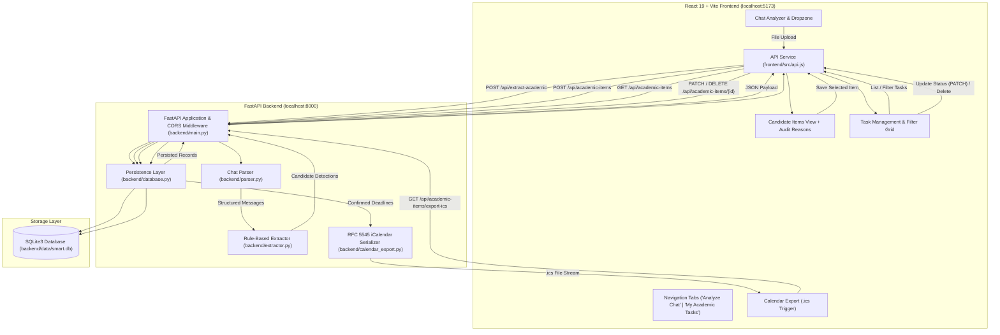
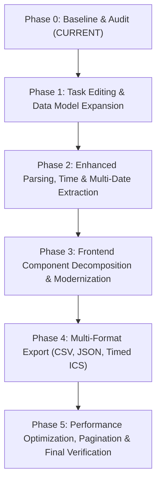

# SMART 2.0 — PHASE 0: REPOSITORY AUDIT AND BASELINE REPORT

**Audit Date:** 2026-11-17  
**Auditor:** Senior Software Architect & Code Reviewer  
**Scope:** Phase 0 Codebase Audit, Baseline Verification, and Architecture Analysis  
**Repository Location:** `E:\Projects\SMART`  
**Current Baseline Status:** Verified & Clean (Backend: 41/41 Pytest tests passing; Frontend: Vite 8 production build passing with 0 errors)

---

## Executive Summary

SMART (Academic Intelligence Dashboard) is an offline, privacy-first full-stack application designed to ingest WhatsApp `.txt` group chat exports, parse raw conversations into structured message objects, extract candidate academic notices (assignments, exams, announcements, opportunities, events) using deterministic rule-based algorithms, persist user-confirmed academic tasks into a local SQLite database, and export deadlines to RFC 5545 `.ics` calendar files.

This Phase 0 audit establishes the definitive baseline of the existing codebase. No application source code, database schemas, or dependency files were modified during this phase.

---

## 1. Existing Architecture Overview

### 1.1 High-Level Architecture

The current application consists of a decoupled two-tier architecture:
1. **Frontend:** Single-Page Application (SPA) built with React 19 and Vite 8, utilizing native Fetch API wrappers and vanilla CSS.
2. **Backend:** Asynchronous Python service powered by FastAPI, Uvicorn, and standard library `sqlite3` operating in Write-Ahead Logging (WAL) mode.



### 1.2 End-to-End Data Flow

The lifecycle of an academic item from WhatsApp raw text to calendar export flows through the following stages:

```
[WhatsApp .txt Export]
         │
         ▼
[1. Frontend Upload & Validation]
  - File picker or drag-and-drop (.txt only, <= 5 MB, non-empty)
  - Transmitted via FormData (multipart/form-data)
         │
         ▼
[2. Backend Ingestion: POST /api/extract-academic]
  - backend/main.py:_read_and_validate_file verifies UTF-8 decoding (handling UTF-8 BOM)
  - Rejects oversized files (>5MB with HTTP 413) or non-txt/empty files (HTTP 400)
         │
         ▼
[3. Chat Normalization & Parsing: backend/parser.py]
  - Strips invisible directional Unicode marks (\u200e, \u200f, \u202a-\u202e, \ufeff)
  - Normalizes narrow non-breaking spaces (\u202f, \xa0)
  - Matches iOS format: [DD/MM/YYYY, HH:MM:SS AM/PM] Sender: Message
  - Matches Android format: DD/MM/YY, HH:MM am - Sender: Message
  - Appends multiline message bodies to previous message record
  - Flags WhatsApp system notifications (e.g., encryption, member joins)
         │
         ▼
[4. Information Extraction: backend/extractor.py]
  - Ignores messages where sender == 'System'
  - Classifies message category via word-boundary regex (\bassignments?\b, \bexams?\b, etc.)
  - Resolves dates:
    * Relative dates ("today", "tomorrow", "day after tomorrow") against message timestamp
    * Explicit full dates (Day-Month-Year, Month-Day-Year, ISO YYYY-MM-DD, DD/MM/YYYY)
    * Dates without year: due_date kept NULL, flagged with needs_review
    * Ambiguous numeric dates (both numbers <= 12): flagged with needs_review
  - Distinguishes deadline indicators ("due", "submit by", "deadline") vs mentioned dates
  - Extracts and deduplicates URLs, stripping trailing punctuation
  - Preserves verbatim source evidence: sender, timestamp, original message text
         │
         ▼
[5. Candidate Review on Frontend: Analyze Chat Tab]
  - Displays candidate item cards with category pills, review warnings, and date status
  - Expandable accordion allows inspection of original source message
  - User clicks "+ Save to Tasks"
         │
         ▼
[6. Persistence & Deduplication: POST /api/academic-items]
  - backend/database.py:find_duplicate_item checks provenance:
    (source_text, source_timestamp, source_sender, category, source_filename)
  - If identical: returns HTTP 409 Conflict with existing task ID
  - If new: validates category, status, and ISO date, inserts record, returns HTTP 201 Created
         │
         ▼
[7. Task Management: My Academic Tasks Tab]
  - Frontend queries GET /api/academic-items (ordered chronologically by due_date, then undated)
  - User can update status (pending -> completed -> dismissed) via PATCH /api/academic-items/{id}
  - User can permanently delete via DELETE /api/academic-items/{id} with confirmation modal
         │
         ▼
[8. Deadline Export: GET /api/academic-items/export-ics]
  - backend/calendar_export.py fetches items with valid due_date AND date_type = 'deadline'
  - Applies RFC 5545 text escaping (\, ;, ,, \n) and 75-octet line folding
  - Returns text/calendar attachment (smart_academic_deadlines.ics)
```

---

## 2. Existing Functionality Inventory

| Component / Subsystem | Feature / Capability | Implementation Details | Status / Health |
| :--- | :--- | :--- | :--- |
| **Parser** (`parser.py`) | Android format matching | Regex: `\d{1,2}[/.-]\d{1,2}[/.-]\d{2,4},\s*\d{1,2}:\d{2}...\s*[-–—]\s*` | Working (Tested) |
| **Parser** (`parser.py`) | iOS format matching | Regex: `\[\d{1,2}[/.-]\d{1,2}[/.-]\d{2,4},\s*\d{1,2}:\d{2}...\]\s*` | Working (Tested) |
| **Parser** (`parser.py`) | Unicode normalization | Regex stripping `\u200e`, `\u200f`, `\ufeff`; normalizing `\u202f`, `\xa0` | Working (Tested) |
| **Parser** (`parser.py`) | Multiline message aggregation | Appends subsequent non-timestamped lines to active message | Working (Tested) |
| **Parser** (`parser.py`) | System notice suppression | Matches known phrases ("end-to-end encrypted", "created group", etc.) | Working (Tested) |
| **Extractor** (`extractor.py`) | Word-boundary classification | Regex word boundaries `\b` for 5 categories (Assignment, Exam, Announcement, Event, Opportunity) | Working (Tested) |
| **Extractor** (`extractor.py`) | Full explicit date parsing | Supports DD/MM/YYYY, ISO, and Month Name dates with year | Working (Tested) |
| **Extractor** (`extractor.py`) | Relative date resolution | Resolves "tomorrow", "day after tomorrow", "today" against message timestamp | Working (Tested) |
| **Extractor** (`extractor.py`) | Conservative year handling | Day/Month without year is flagged `needs_review`; never invents year | Working (Tested) |
| **Extractor** (`extractor.py`) | Ambiguous numeric detection | Flags `DD/MM` vs `MM/DD` ambiguity when both numbers <= 12 and distinct | Working (Tested) |
| **Extractor** (`extractor.py`) | Deadline vs Event distinction | Categorizes date as `deadline` if deadline keywords present, else `event_date` or `mentioned_date` | Working (Tested) |
| **Extractor** (`extractor.py`) | URL extraction & cleanup | Extracts HTTP/HTTPS links, strips trailing brackets/punctuation, deduplicates | Working (Tested) |
| **Extractor** (`extractor.py`) | Evidence preservation | Stores exact `source_sender`, `source_timestamp`, and `source_text` | Working (Tested) |
| **Database** (`database.py`) | SQLite schema & indexes | `academic_items` table with indexes on category, status, due_date, and dedup | Working (Tested) |
| **Database** (`database.py`) | Provenance deduplication | Checks `source_text`, `source_timestamp`, `source_sender`, `category`, `source_filename` | Working (Tested) |
| **Database** (`database.py`) | Deterministic ordering | Orders upcoming dated items first chronologically, then undated items, ID desc | Working (Tested) |
| **Database** (`database.py`) | Status lifecycle transitions | Supports `pending`, `completed`, `dismissed`, updating `updated_at` | Working (Tested) |
| **Calendar** (`calendar_export.py`) | RFC 5545 iCalendar generation | Outputs `VCALENDAR` and `VEVENT` records with unique `UID` and UTC `DTSTAMP` | Working (Tested) |
| **Calendar** (`calendar_export.py`) | RFC 5545 text escaping | Escapes backslashes, semicolons, commas, and normalizes newlines to `\n` | Working (Tested) |
| **Calendar** (`calendar_export.py`) | RFC 5545 line folding | Folds lines exceeding 75 octets with CRLF + space | Working (Tested) |
| **Calendar** (`calendar_export.py`) | Strict deadline filtering | Excludes mentioned dates, event dates, and undated items from `.ics` | Working (Tested) |
| **API** (`main.py`) | Health endpoint | `GET /api/health` returning status and metadata | Working (Tested) |
| **API** (`main.py`) | Chat upload & parse | `POST /api/upload-chat` parsing raw messages | Working (Tested) |
| **API** (`main.py`) | Academic extraction | `POST /api/extract-academic` extracting candidate items | Working (Tested) |
| **API** (`main.py`) | Academic item persistence | `POST /api/academic-items` with validation and deduplication (409 Conflict) | Working (Tested) |
| **API** (`main.py`) | Academic item queries | `GET /api/academic-items` with filtering (category, status, search, due dates) | Working (Tested) |
| **API** (`main.py`) | Item retrieval & update | `GET /api/academic-items/{id}` and `PATCH /api/academic-items/{id}` | Working (Tested) |
| **API** (`main.py`) | Item deletion | `DELETE /api/academic-items/{id}` | Working (Tested) |
| **API** (`main.py`) | iCalendar download | `GET /api/academic-items/export-ics` (and alias `/export.ics`) | Working (Tested) |
| **Frontend** (`App.jsx`) | Dual-tab dashboard | "Analyze Chat" and "My Academic Tasks" tabs | Working (Verified) |
| **Frontend** (`App.jsx`) | Drag-and-drop file ingestion | Interactive dropzone with size (5MB) and type (.txt) validation | Working (Verified) |
| **Frontend** (`App.jsx`) | Candidate cards with audit tags | Displays category, date, review explanations, URLs, and source evidence | Working (Verified) |
| **Frontend** (`App.jsx`) | Interactive task saving | Buttons transition `Save to Tasks` -> `Saving...` -> `✓ Already Saved` | Working (Verified) |
| **Frontend** (`App.jsx`) | Task management & counters | Displays metrics (Total, Pending, Completed, Deadlines) | Working (Verified) |
| **Frontend** (`App.jsx`) | Search and filter controls | Search input, date range filters, category pills, status tabs | Working (Verified) |
| **Frontend** (`App.jsx`) | Deletion modal | Accessible confirmation modal before deleting tasks | Working (Verified) |

---

## 3. Backend and Frontend Dependency Overview

### 3.1 Backend Dependencies (`backend/requirements.txt`)

| Package | Version Constraint | Active Runtime Version | Role / Purpose |
| :--- | :--- | :--- | :--- |
| `fastapi` | `>=0.115.0` | 0.115.x / Python 3.14 compatible | Core web framework, routing, request validation |
| `uvicorn[standard]` | `>=0.30.0` | 0.30.x+ | ASGI web server |
| `python-multipart` | `>=0.0.9` | 0.0.9+ | Multipart form-data handling for file uploads |
| `pydantic` | `>=2.0.0` | 2.x | Data validation and serialization models |
| `pytest` | `>=8.0.0` | 9.1.1 | Test runner and test execution harness |
| `httpx` | `>=0.27.0` | 0.27.x | HTTP client utilized by FastAPI `TestClient` |
| `python-dateutil` | `>=2.9.0` | 2.9.0 | Date parsing utility library |

*Note on standard library usage:* The backend persistence layer uses Python's standard library `sqlite3` directly with parameterized SQL queries. No external ORM (such as SQLAlchemy, SQLModel, or Peewee) is currently employed.

### 3.2 Frontend Dependencies (`frontend/package.json`)

#### Production Dependencies
| Package | Version Constraint | Active Version | Role / Purpose |
| :--- | :--- | :--- | :--- |
| `react` | `^19.2.8` | 19.2.8 | Core UI library |
| `react-dom` | `^19.2.8` | 19.2.8 | DOM rendering engine for React |

#### Developer Dependencies
| Package | Version Constraint | Active Version | Role / Purpose |
| :--- | :--- | :--- | :--- |
| `vite` | `^8.3.0` | 8.3.4 | Next-generation frontend bundler and dev server |
| `@vitejs/plugin-react` | `^6.1.1` | 6.1.1 | React Fast Refresh and JSX transformation |
| `eslint` | `^10.10.0` | 10.10.0 | JavaScript/JSX linter |
| `@eslint/js` | `^10.0.1` | 10.0.1 | ESLint core JavaScript recommended configs |
| `eslint-plugin-react-hooks` | `^7.1.1` | 7.1.1 | Linting rules for React Hooks |
| `eslint-plugin-react-refresh`| `^0.5.6` | 0.5.6 | Fast Refresh linting integration |
| `globals` | `^17.12.0` | 17.12.0 | Browser global identifier definitions |
| `@types/react` | `^19.2.18` | 19.2.18 | TypeScript definitions for React |
| `@types/react-dom` | `^19.2.7` | 19.2.7 | TypeScript definitions for React DOM |

*Note on UI libraries:* The frontend uses zero external CSS frameworks (no Tailwind CSS, Bootstrap, or Material-UI) and zero third-party component libraries. All styling is implemented in plain CSS inside `frontend/src/App.css` and `frontend/src/index.css`.

---

## 4. Database Schema Overview

The database resides at `backend/data/smart.db` by default and is created automatically upon startup. Connections enforce:
- Foreign keys enabled: `PRAGMA foreign_keys = ON;`
- Write-Ahead Logging: `PRAGMA journal_mode = WAL;`
- Row factory: `sqlite3.Row` for dictionary-like column access.

### 4.1 Table: `academic_items`

```sql
CREATE TABLE IF NOT EXISTS academic_items (
    id INTEGER PRIMARY KEY AUTOINCREMENT,
    title TEXT NOT NULL,
    category TEXT NOT NULL,
    description TEXT,
    date_text TEXT,
    due_date TEXT,
    date_type TEXT,
    date_status TEXT,
    status TEXT NOT NULL DEFAULT 'pending',
    source_sender TEXT,
    source_timestamp TEXT,
    source_text TEXT NOT NULL,
    source_filename TEXT,
    review_required INTEGER NOT NULL DEFAULT 0,
    review_reasons TEXT,
    created_at TEXT NOT NULL,
    updated_at TEXT NOT NULL
);
```

### 4.2 Column Specifications

| Column Name | Data Type | Nullable | Constraints & Defaults | Description |
| :--- | :--- | :--- | :--- | :--- |
| `id` | `INTEGER` | No | `PRIMARY KEY AUTOINCREMENT` | Unique identifier for each saved task. |
| `title` | `TEXT` | No | | Summary title of the academic notice or deadline. |
| `category` | `TEXT` | No | Allowed: `Assignment`, `Exam`, `Announcement`, `Event`, `Opportunity` | Academic classification. |
| `description` | `TEXT` | Yes | Defaults to `source_text` if omitted | Context, submission guidelines, or notes. |
| `date_text` | `TEXT` | Yes | | Raw text representation of date extracted from chat. |
| `due_date` | `TEXT` | Yes | Format: `YYYY-MM-DD` | Resolved ISO date string. |
| `date_type` | `TEXT` | Yes | Default: `'unknown'` (`deadline`, `mentioned_date`, `event_date`, `none`) | Functional type of date. |
| `date_status` | `TEXT` | Yes | Default: `'not_found'` (`parsed`, `resolved_from_message_date`, `needs_review`) | Confidence rating of date parsing. |
| `status` | `TEXT` | No | `DEFAULT 'pending'` (`pending`, `completed`, `dismissed`) | Lifecycle state of the academic task. |
| `source_sender`| `TEXT` | Yes | Default: `''` | Original sender name or phone from WhatsApp export. |
| `source_timestamp` | `TEXT` | Yes | Default: `''` | Original timestamp header string from chat. |
| `source_text` | `TEXT` | No | | Full unaltered original WhatsApp message body. |
| `source_filename` | `TEXT` | Yes | Default: `''` | Name of the source `.txt` file. |
| `review_required` | `INTEGER` | No | `DEFAULT 0` (0 or 1) | Flag indicating whether human review is required. |
| `review_reasons` | `TEXT` | Yes | JSON string (e.g. `'["Date lacks year"]'`) | Audit trail of reasons triggering review flag. |
| `created_at` | `TEXT` | No | ISO 8601 UTC timestamp | Record creation timestamp. |
| `updated_at` | `TEXT` | No | ISO 8601 UTC timestamp | Record last update timestamp. |

### 4.3 Database Indexes

| Index Name | Target Table | Indexed Columns | Objective |
| :--- | :--- | :--- | :--- |
| `idx_academic_items_category` | `academic_items` | `(category)` | Fast category filtering |
| `idx_academic_items_status` | `academic_items` | `(status)` | Fast lifecycle status queries |
| `idx_academic_items_due_date` | `academic_items` | `(due_date)` | Chronological sorting and range queries |
| `idx_academic_items_dedup` | `academic_items` | `(source_text, source_timestamp, source_sender, category)` | Provenance deduplication lookups |

---

## 5. Existing Test Results

Both the backend automated test suite and the frontend production build were executed without modifying application source code.

### 5.1 Backend Test Execution

- **Command:** `py -m pytest -v`
- **Working Directory:** `E:\Projects\SMART`
- **Python Environment:** Python 3.14.7 (win32), pytest 9.1.1, pluggy 1.7.0
- **Isolation:** Configured via `backend/tests/conftest.py` with `tmp_path` monkeypatching `SMART_DB_PATH`.

#### Actual Terminal Output:
```
============================= test session starts =============================
platform win32 -- Python 3.14.7, pytest-9.1.1, pluggy-1.7.0 -- C:\Users\OFFICE\AppData\Local\Programs\Python\Python314\python.exe
cachedir: .pytest_cache
rootdir: E:\Projects\SMART
plugins: anyio-4.15.1
collecting ... collected 41 items

backend/tests/test_api.py::test_health_check_endpoint PASSED             [  2%]
backend/tests/test_api.py::test_upload_non_txt_file_rejected PASSED      [  4%]
backend/tests/test_api.py::test_upload_empty_file_rejected PASSED        [  7%]
backend/tests/test_api.py::test_upload_whitespace_only_file_rejected PASSED [  9%]
backend/tests/test_api.py::test_upload_oversized_file_rejected PASSED    [ 12%]
backend/tests/test_api.py::test_upload_unrecognized_format_rejected PASSED [ 14%]
backend/tests/test_api.py::test_extract_academic_with_sample_fixture PASSED [ 17%]
backend/tests/test_api.py::test_cors_headers_present PASSED              [ 19%]
backend/tests/test_extractor.py::test_classify_message_word_boundaries_prevent_false_positives PASSED [ 21%]
backend/tests/test_extractor.py::test_classify_message_valid_categories PASSED [ 24%]
backend/tests/test_extractor.py::test_explicit_dates_parsing PASSED      [ 26%]
backend/tests/test_extractor.py::test_relative_dates_resolution PASSED   [ 29%]
backend/tests/test_extractor.py::test_dates_without_explicit_year PASSED [ 31%]
backend/tests/test_extractor.py::test_ambiguous_numeric_dates PASSED     [ 34%]
backend/tests/test_extractor.py::test_url_extraction_punctuation_and_deduplication PASSED [ 36%]
backend/tests/test_extractor.py::test_irrelevant_messages_not_extracted PASSED [ 39%]
backend/tests/test_extractor.py::test_system_messages_not_extracted PASSED [ 41%]
backend/tests/test_extractor.py::test_deadline_vs_mentioned_date_distinction PASSED [ 43%]
backend/tests/test_extractor.py::test_source_evidence_preservation PASSED [ 46%]
backend/tests/test_parser.py::test_android_style_parsing PASSED          [ 48%]
backend/tests/test_parser.py::test_ios_style_parsing PASSED              [ 51%]
backend/tests/test_parser.py::test_ios_style_with_narrow_spaces_and_unicode_lrm PASSED [ 53%]
backend/tests/test_parser.py::test_multiline_messages PASSED             [ 56%]
backend/tests/test_parser.py::test_system_notifications_without_sender PASSED [ 58%]
backend/tests/test_parser.py::test_messages_with_additional_colons PASSED [ 60%]
backend/tests/test_parser.py::test_empty_and_whitespace_input PASSED     [ 63%]
backend/tests/test_parser.py::test_unrecognized_format_input PASSED      [ 65%]
backend/tests/test_persistence.py::test_database_initialization PASSED   [ 68%]
backend/tests/test_persistence.py::test_save_academic_item_api PASSED    [ 70%]
backend/tests/test_persistence.py::test_list_saved_items_deterministic_ordering PASSED [ 73%]
backend/tests/test_persistence.py::test_search_and_category_filters PASSED [ 75%]
backend/tests/test_persistence.py::test_status_filters PASSED            [ 78%]
backend/tests/test_persistence.py::test_date_range_filters PASSED        [ 80%]
backend/tests/test_persistence.py::test_update_task_status_lifecycle PASSED [ 82%]
backend/tests/test_persistence.py::test_invalid_status_and_dates_rejected PASSED [ 85%]
backend/tests/test_persistence.py::test_nonexistent_item_ids_return_404 PASSED [ 87%]
backend/tests/test_persistence.py::test_delete_saved_item PASSED         [ 90%]
backend/tests/test_persistence.py::test_duplicate_save_rejected_with_conflict PASSED [ 92%]
backend/tests/test_persistence.py::test_export_confirmed_deadlines_ics PASSED [ 95%]
backend/tests/test_persistence.py::test_export_excludes_non_deadlines PASSED [ 97%]
backend/tests/test_persistence.py::test_icalendar_text_escaping PASSED   [100%]

============================== warnings summary ===============================
C:\Users\OFFICE\AppData\Local\Programs\Python\Python314\Lib\site-packages\fastapi\testclient.py:1
  C:\Users\OFFICE\AppData\Local\Programs\Python\Python314\Lib\site-packages\fastapi\testclient.py:1: StarletteDeprecationWarning: Using `httpx` with `starlette.testclient` is deprecated; install `httpx2` instead.
    from starlette.testclient import TestClient as TestClient  # noqa

-- Docs: https://docs.pytest.org/en/stable/how-to/capture-warnings.html
======================== 41 passed, 1 warning in 6.51s ========================
```

- **Result:** **100% Passed (41/41 tests)**.
- **Warning:** 1 deprecation warning from Starlette regarding `httpx` vs future `httpx2` import convention in `starlette.testclient`. No test failures or assertion errors.

---

### 5.2 Frontend Production Build

- **Command:** `npm run build`
- **Working Directory:** `E:\Projects\SMART\frontend`
- **Node & Vite:** Vite v8.3.4, React 19.2.8

#### Actual Terminal Output:
```
> frontend@0.0.0 build
> vite build

vite v8.3.4 building client environment for production...
transforming...
✓ 18 modules transformed.
rendering chunks...
computing gzip size...
dist/index.html                   0.70 kB │ gzip:  0.43 kB
dist/assets/index-BanNG6ZF.css   20.63 kB │ gzip:  4.43 kB
dist/assets/index-btD2mf3m.js   249.54 kB │ gzip: 75.92 kB

✓ built in 553ms
```

- **Result:** **Clean Build (0 errors, 0 warnings)**.

### 5.3 Frontend Linter Verification

- **Command:** `npm run lint`
- **Working Directory:** `E:\Projects\SMART\frontend`

#### Actual Terminal Output:
```
> frontend@0.0.0 lint
> eslint .
```

- **Result:** **Clean Linting (0 errors, 0 warnings)**.

---

## 6. Potential Technical Issues and Architectural Limitations

A detailed code review identified the following limitations and potential architectural concerns:

### 6.1 Frontend Architecture Limitations

1. **Monolithic UI Component (`App.jsx` — 1,288 lines):**
   - The entire frontend (tab routing, chat upload dropzone, analysis report rendering, candidate card rendering, task filtering, statistics calculation, task card rendering, inline status buttons, and delete modal) resides in a single component.
   - *Risk:* Makes future feature additions error-prone and hard to maintain. Difficult to unit-test sub-components independently.
2. **Candidate Card Save Indexing Bug under Filtered Views:**
   - In `App.jsx`, candidate cards are tracked in `saveStatusMap` using array indices (`idx`).
   - When users apply a category filter (`selectedFilter !== 'ALL'`), `filteredCandidateItems.map((item, idx))` passes the *filtered index* instead of the candidate's canonical item ID or original array index.
   - *Risk:* When filtering by category, clicking "Save to Tasks" on the 1st visible item updates `saveStatusMap[0]`, potentially showing "Already Saved" on an unrelated item when switching back to "All Items".
3. **Redundant Dual Filtering (Client vs Server):**
   - The backend `GET /api/academic-items` supports full query filtering (`category`, `status`, `search`, `due_before`, `due_after`).
   - However, `App.jsx` fetches all tasks unconditionally via `getAcademicItems()` and re-filters them client-side in React using `useMemo`.
   - *Risk:* Redundant logic maintenance; will not scale if hundreds or thousands of tasks are stored.
4. **Lack of React Error Boundaries:**
   - `frontend/src/main.jsx` renders `<App />` directly inside `<StrictMode>` without an `<ErrorBoundary>`.
   - *Risk:* Any unexpected rendering exception (e.g. malformed data in state) will crash the entire React application into a blank white screen.

### 6.2 Backend & Data Processing Limitations

5. **Lack of Task Edit Endpoints & UI:**
   - Currently, `PATCH /api/academic-items/{id}` ONLY allows updating `status` (`pending`, `completed`, `dismissed`).
   - There is no endpoint or UI modal to correct an extracted title, edit description, change category, or manually assign a date when extraction flags `needs_review`.
   - *Risk:* If a date or title is extracted imperfectly, students have no way to correct it without raw database access.
6. **Date Time & Granularity Loss:**
   - `extractor.py` and `database.py` store dates strictly as `YYYY-MM-DD` strings without times.
   - If a message states *"Assignment submission deadline is due on 28/10/2026 before 11:59 pm"*, the `11:59 pm` time specification is dropped from structured storage.
   - Consequently, `.ics` calendar exports only generate all-day `VALUE=DATE` events rather than specific time deadlines.
7. **Single Date Detection per Message:**
   - `detect_date()` returns the first matched date expression.
   - In messages containing both a start date and an end date (e.g., *"Registration opens 10/11/2026 and closes on 25/11/2026"*), only the first date is extracted.
8. **Deduplication Dependency on `source_filename`:**
   - `database.py:find_duplicate_item` checks:
     `AND (TRIM(COALESCE(source_filename, '')) = ?)`
   - If a student uploads the same chat from two different devices (e.g., `chat.txt` vs `WhatsApp Chat - CS.txt`), deduplication fails to recognize the duplicate because filenames differ.
9. **Missing Weekday / Contextual Date Parsing:**
   - The extractor handles "today", "tomorrow", "day after tomorrow", and explicit month/numeric dates.
   - However, conversational phrasing like *"due this Friday"*, *"next Monday"*, or *"by end of week"* is not parsed into dates and defaults to unconfirmed status.
10. **Synchronous Schema Initialization on Module Import:**
    - `database.py` executes `init_db()` on top-level import (line 433).
    - `main.py` also executes `init_db()` on top-level import (line 44) AND in `lifespan`.
    - *Risk:* Top-level side effects make imports slower and can interfere with CLI tooling or isolated test setups that specify custom database paths.

---

## 7. Recommended SMART 2.0 Implementation Sequence

To ensure seamless progress without regressing existing features or failing tests, SMART 2.0 should be implemented across strictly sequential phases:



### Detailed Phase Roadmap

1. **Phase 1: Task Editing & Data Model Expansion**
   - Extend `AcademicItemStatusUpdate` or introduce `AcademicItemUpdate` Pydantic model to allow updating `title`, `description`, `category`, `due_date`, and `due_time`.
   - Update `database.py` to support safe updates of editable task fields while updating `updated_at`.
   - Add backend tests verifying partial updates and validation rules.
2. **Phase 2: Enhanced Parsing, Time & Multi-Date Extraction**
   - Enhance `parser.py` regex to support 24-hour clocks without AM/PM and European/international date separators (`.` and `-`).
   - Enhance `extractor.py` to capture deadline times (e.g., `11:59 pm`, `23:59`, `5:00 pm`).
   - Add weekday resolution ("Friday", "next Monday") relative to the message timestamp.
   - Refactor candidate deduplication to avoid brittle filename mismatches.
3. **Phase 3: Frontend Component Decomposition & Modernization**
   - Decompose `App.jsx` into modular components under `frontend/src/components/`:
     - `components/Navbar.jsx`
     - `components/TabSwitcher.jsx`
     - `components/ChatAnalyzer.jsx` (Dropzone, Upload status)
     - `components/CandidateCard.jsx` (Evidence, Review reasons, Save button)
     - `components/TaskManager.jsx` (Stats grid, Filters)
     - `components/TaskCard.jsx` (Status updater, Evidence accordion, Action buttons)
     - `components/TaskEditModal.jsx` (Form to edit title, date, time, category)
     - `components/DeleteModal.jsx` (Existing confirmation modal)
     - `components/ErrorBoundary.jsx` (Catch rendering errors)
   - Fix candidate save indexing by binding to item UUID/hash instead of array index.
   - Integrate task edit modal.
4. **Phase 4: Multi-Format Export & Timed Calendar Events**
   - Update `calendar_export.py` to output timed `VEVENT` entries (`DTSTART:YYYYMMDDTHHMMSSZ`) when deadline time is available, falling back to `VALUE=DATE`.
   - Add endpoints for CSV (`/api/academic-items/export-csv`) and JSON export for backup/portability.
5. **Phase 5: Pagination, Optimization & End-to-End Verification**
   - Add `limit` and `offset` support to `list_academic_items`.
   - Ensure all 41 existing backend regression tests continue passing and expand the suite for new SMART 2.0 features.
   - Validate full production build and test coverage.

---

## 8. Exact Files Likely to Require Modifications

### 8.1 Backend Files

| File Path | Current Status | Modifications Anticipated for SMART 2.0 |
| :--- | :--- | :--- |
| `backend/main.py` | 374 lines | Add `AcademicItemUpdate` schema, expand `PATCH /api/academic-items/{id}` to accept edits, add CSV/JSON export endpoints, add pagination parameters. |
| `backend/database.py` | 436 lines | Add `update_academic_item_full()` function, add optional `due_time` column handling, enhance deduplication provenance logic, remove top-level synchronous `init_db()` side effect. |
| `backend/extractor.py` | 493 lines | Add time regex extraction, support weekday resolution ("Friday", "next Monday"), extract multiple dates/deadlines per message. |
| `backend/parser.py` | 132 lines | Add regex patterns for 24-hour timestamps and international date delimiters (`.` format). |
| `backend/calendar_export.py` | 142 lines | Add support for timed `VEVENT` entries with UTC conversion when `due_time` exists. |
| `backend/requirements.txt` | 7 dependencies | Review if additional utilities (e.g., date parsing or CSV tools) are needed; keep lean. |
| `backend/tests/test_api.py` | 102 lines | Add test cases for task editing, pagination, and multi-format exports. |
| `backend/tests/test_extractor.py`| 174 lines | Add test cases for time extraction and weekday resolution. |
| `backend/tests/test_parser.py` | 85 lines | Add test cases for 24h formats and international locales. |
| `backend/tests/test_persistence.py`| 532 lines | Add test cases for full task edits, timestamps, and timed `.ics` exports. |

### 8.2 Frontend Files

| File Path | Current Status | Modifications Anticipated for SMART 2.0 |
| :--- | :--- | :--- |
| `frontend/src/App.jsx` | 1,288 lines | Decompose into modular components, replace index-based candidate tracking with unique item keys, connect task edit modal. |
| `frontend/src/api.js` | 209 lines | Add `updateAcademicItem(itemId, fields)` for full task edits, add helper for CSV export. |
| `frontend/src/App.css` | 913 lines | Add styles for task edit modal, time display chips, pagination controls. |
| `frontend/src/main.jsx` | 10 lines | Wrap `<App />` with `<ErrorBoundary>`. |

### 8.3 Anticipated New Files

| File Path | Purpose |
| :--- | :--- |
| `frontend/src/components/Navbar.jsx` | Modular top brand navigation bar |
| `frontend/src/components/Dropzone.jsx` | File selection and drag-drop upload card |
| `frontend/src/components/CandidateCard.jsx` | Candidate item card with evidence accordion and save button |
| `frontend/src/components/TaskCard.jsx` | Persisted task card with status toggles, edit trigger, and delete trigger |
| `frontend/src/components/TaskEditModal.jsx` | Modal dialog allowing user to edit title, category, date, and time |
| `frontend/src/components/DeleteModal.jsx` | Accessible confirmation dialog for deletion |
| `frontend/src/components/ErrorBoundary.jsx` | Fallback UI component for unexpected React exceptions |

---

## 9. Baseline Audit Confirmation & Conclusion

- **Code Integrity:** All existing application code and schema definitions remain intact and unmodified.
- **Test Integrity:** All **41 pytest tests** passed cleanly (`41 passed, 1 warning in 6.51s`).
- **Build Integrity:** Frontend build compiled cleanly (`built in 553ms`, Vite 8, zero errors/warnings).
- **Audit Deliverable:** Stored as `SMART_PHASE0_AUDIT.md` in workspace root.

**Phase 0 is complete. Awaiting explicit instruction before beginning Phase 1.**
